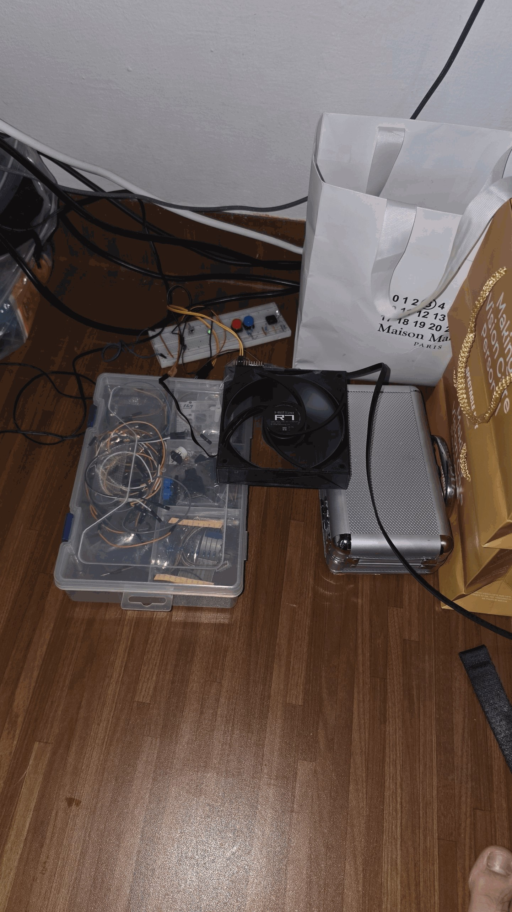
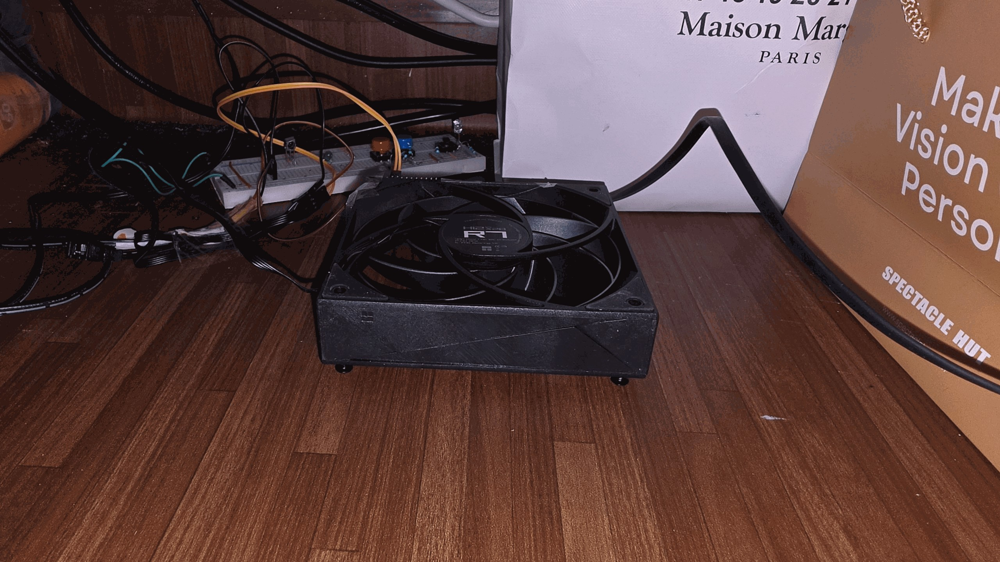
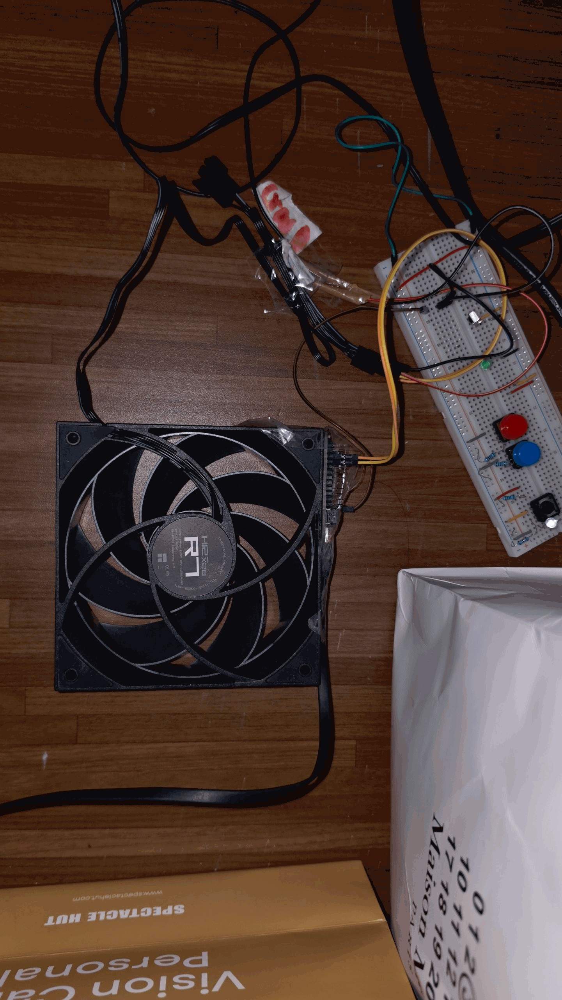
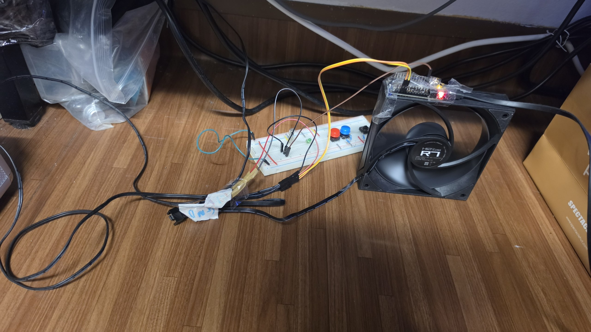

# Bench setup

| Mount id | Fan placement | Used | Status |
|---|---|---|---|
| `tapeCorner` | Standing on its edge, free on the floor; board taped on the frame's top edge | 18–19 Nov 2026 (bring-up, 7.4 h healthy overnight campaign) | Retired 19 Nov |
| (trial, not recorded) | Flat on four corner screws about 5 mm off the floor | 19 Nov 2026, a few minutes | Dropped: the 5 mm gap choked the inlet |
| `flat4` | Lying flat, bridging the gap between two heavy boxes, corners taped to the boxes; board on a side wall at the same corner | From 19 Nov 2026 | **Current**. Mount check 08:48 passed |

## `flat4` (current)

- **Fan:** the same `pc01`, lying flat with the hub label and struts facing **up**.
  - It bridges the gap between a plastic component organiser (left) and an aluminium case (right). Each side of the frame rests on one box and the corners are taped down.
  - The struts are on top. On standard axial fans that is the outlet, so it blows up and draws air from the gap between the boxes.
- **Board:** taped vertically to the outer side wall at the same frame corner as in `tapeCorner`, header pins pointing outward. The trial photos below show the board and wiring close up; they are unchanged in `flat4`.
- **Box positions** are marked on the floor. Don't open, move or use the boxes until the fault experiments on this mount are finished.
- **Board axes,** relative to the fan, are unchanged because the board turned with the fan:

  | Board axis | Fan direction | Absolute direction in `flat4` |
  |---|---|---|
  | y | fan axis | vertical (gravity +0.991 g) |
  | x, z | rotor plane | horizontal |

  The board is tilted 3.4° from the fan axis (x −0.037 g, z +0.046 g). The magnetometer's 2× is about 2 mG on y and 300–500 mG on x and z.

### Mount check, 19 Nov 08:48 (`data/bringup/20261119-084841_pc01_normal_none`)

- **Clean data:** 0 CRC errors, lost frames, overruns or audio drops.
- **Stable:**
  - The three thirds of the 3-min hold at 70 % agree within 3 %.
  - The repeat of 50 % matches the first (rms 11.4 vs 11.5 mg).
  - Gravity moved 0.19° in the first minutes, then held.
  - No peaks at a fixed frequency, so nothing on the boxes is rattling.
- **The rocking is gone.**
  - 0.5× is at most 0.3 mg; `tapeCorner` reached 37 mg at 100 %.
  - At 30–60 %, 1× is only 0.2–4 mg axial and 0.2–1 mg in-plane; `tapeCorner` had 25–32 mg fore-aft.
- **High-speed bounce.** At 80–100 %, the axial (vertical) 1× rises steeply: 19, 45 and 64 mg at 80, 90 and 100 %. The fan is bouncing on the boxes near 40 Hz. It is steady within each step (sd ≤ 0.015 log10) and has no subharmonics.
- **Speed and sound changed.** The fan runs about 3.5 % slower at every duty than in `tapeCorner` (2402 vs 2486 rpm at 100 %), and the blade-pass tone is 10–17 dB louder. Likely causes:
  - the box tops covering part of the inlet,
  - the microphone now facing sideways.

  This doesn't matter as long as nothing moves.
- **Where the Blu-Tack should show:** in-plane 1× (x, z) at 30–70 %, where the healthy baseline is about 1 mg.

### Trial: flat on screws, 5 mm off the floor (not recorded)

| Side view | Top view (board and wiring, same as `flat4`) |
|---|---|
|  |  |

The 5 mm gap under a 120 mm fan is about 24 cm² of side opening, roughly a fifth of the inlet area. It was replaced by the box bridge before any recording.

## `tapeCorner` (retired 19 Nov)

## Fan `pc01`

- **Model:** Thermalright **TL-H12-X28-R7**. 120 × 120 × 28 mm, 4-pin PWM, 12 V, rated 2400 rpm. The hub label reads "S-FDB Bearing V2" (fluid dynamic bearing).
- **Measured on the bench:**
  - About 720 rpm at 30 % duty and about 2490 rpm at 100 %.
  - Tach gives 2 pulses per revolution.
  - **7 blades:** the audio blade-pass peak is at 7× rotation.
  - **4-pole motor:** the magnetometer peak is at 2× rotation.
  - A 12× family in accel and audio is probably motor cogging.
- **Placement:** stands upright on its edge, **free on a wooden floor** (not clamped), axis horizontal. Nothing holds it in place but its weight.

## Board and mount (`--mount tapeCorner`)

- **Board:** Adafruit Feather nRF52840 Sense (original revision, LSM6DS33), lying flat on the **top edge of the fan frame near one corner**. It is held by clear tape wrapped around the frame.
- **Wires:** three jumper wires (PWM, tach, GND) run from the board's header to a breadboard about 30 cm away. The breadboard joins the fan's 4-pin cable, the 12 V supply and the shared ground. The USB cable leaves the board towards the PC.
- **Board axes vs fan,** deduced from the data (gravity, and the magnetometer's 2× signal, which lies in the rotor plane):

  | Board axis | Fan direction |
  |---|---|
  | z | vertical, up (gravity +1.005 g) |
  | y | along the fan axis (fore-aft, the direction of the airflow) |
  | x | horizontal, in the rotor plane (along the top edge) |

## What this setup does to the signals (19 Nov overnight data)

- **The healthy 1× is almost all fore-aft rocking.**
  - Accel 1× is along y at 29–37 mg; x and z are only 1–4 mg.
  - Gyro 1× is mostly rotation about x.
  - The fan tips back and forth on its narrow 28 mm base once per revolution; that is the softest mode of a fan standing free.
- **At 90–100 % the same rocking appears at 0.5×.** Accel y reaches 37 mg and gyro about x 1.4 dps. That is the frame rattling on the floor, not the tape.
- **Where an added mass should show.** A static imbalance (Blu-Tack on one blade) adds a force that rotates in the rotor plane. It should show most in **x and z 1×**, where the healthy baseline is small.
- **Things that can shift the baseline:**
  - Pulling the wires or USB cable.
  - Moving the fan on the floor.
  - Pressing on the frame.

## Rules for a fault night (any setup)

- **Mark the fan's position on the floor** (tape at two corners) and the cable routing before the run.
- When adding or removing mass, hold the frame still with one hand. Don't lift or slide the fan, and don't touch the board or its wires.
- Use A-B-A with a sham-touch run (see `results/own/overnight/REPORT.md`, section 9).
- **Unplug the 12 V supply** before touching the blades.

## Possible improvement later (as a new mount id, not mid-experiment)

- Fix the fan to a heavy base or plank through its screw holes, or stand it on a rubber mat.
- Strain-relieve the jumper wires and the USB cable a few cm from the board.

This should remove most of the rocking and the slow drift. Record it under a new `--mount`, which also gives a second mount for the benign-drift scenario.
