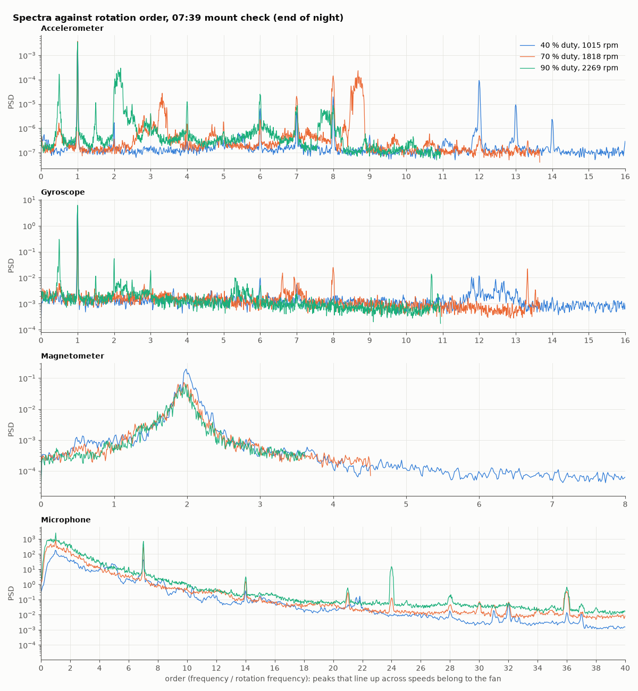
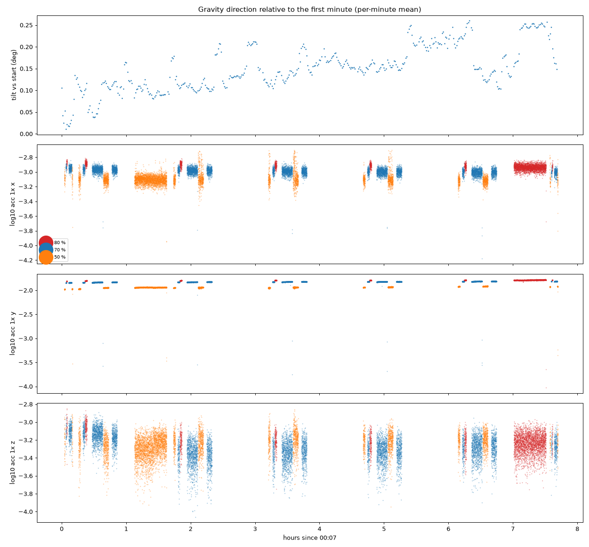
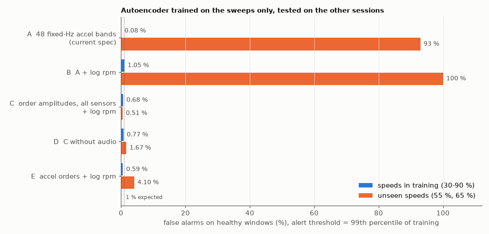

# Overnight healthy-fan campaign, 18–19 Nov 2026

The fan was healthy: a Thermalright TL-H12-X28-R7, 120 mm, standing free on its edge on a wooden floor. The Feather nRF52840 Sense was taped flat on the top edge of the fan frame near a corner (mount id `tapeCorner`). Photo and axis mapping: [`docs/setup/bench_setup.md`](../../../docs/setup/bench_setup.md). The campaign ran from 00:07 to 07:49, with logger 0.3.0 for the recordings and 0.3.1 for the morning tach check. It was recorded with `host/fanlog/campaign.py` and analysed with the scripts in `host/analysis/`.

## Summary

- **Data.** 7.4 h of continuous, clean data from every onboard sensor in 22 sessions:
  - Accel and gyro: 22.1 M samples each.
  - Magnetometer: 7.3 M samples.
  - Audio: 7.4 h at 16 kHz.
  - Temperature, humidity, pressure, light and tach.

  There were 0 CRC errors, 0 lost frames, 0 IMU overruns and 0 gaps. The only losses were two 16 ms audio drops at session boundaries.
- **Placement verdict.** The tape mount worked: the fan shows clearly on every motion sensor (1× is about 40 dB above the noise floor) and nothing came loose. The caveats are below: a slow drift over the night and rocking at full speed, both from the fan standing free on its edge.
  - **Update 19 Nov morning:** the fan was moved to lie flat (mount `flat4`, see [`docs/setup/bench_setup.md`](../../../docs/setup/bench_setup.md)), which removed the rocking.
  - The "mount resonances" in the first version of this report turned out to be aliased motor orders (see section 3).
- **The main feature finding, with a caveat** (corrected after review, see section 7):
  - **What holds:** fixed-frequency features fail at fan speeds the model never saw (**93 %** false alarms), and order (per-rotation) features don't (**0.5 %**).
  - **What was overstated:** that ranking used false alarms only. In a synthetic-fault test by an independent reviewer, the same order-feature autoencoder barely reacted to a ×2–3 increase in 1×.
  - **Why:** each feature was normalised by its spread over *all* speeds, and the unseen-speed test is small.
  - So "order features are the right set" was not shown. `host/analysis/feature_eval.py` redoes the comparison properly. With per-axis order features, normalised to the healthy value at the current speed and averaged over about 5 s, a doubled in-plane 1× is detected 99.5 % of the time at 1.3 % false alarms. Unseen speeds remain an open problem (section 7).
- **Bugs found and fixed.**
  - The tach speed was wrong by +1–1.6 % and noisy, because `micros()` on this core only ticks every 976 µs. Fixed in logger 0.3.1.
  - A review then found that 0.3.1's glitch filter could lock onto 1/2 or 1/3 of the speed after a lost edge. Fixed in **logger 0.3.2**, now on the board; tach vs audio blade-pass agree within 0.15 %.
  - Last night's (0.3.0) data was re-analysed with a speed taken from the audio blade-pass peak.
- **Fan facts learned from the data:**
  - 7 blades: the audio blade-pass peak is at 7×.
  - 4-pole motor: the magnetometer peak is at 2× (electrical frequency).
  - A 12× family in accel and audio is probably motor cogging.

## 1. What was recorded

| Cycle (×5, about 90 min) | Content |
|---|---|
| `speed_sweep` | 30→100 % in 10 % steps, 2 min each |
| `constant_10min` | 70 % for 10 min |
| `benign_drift` | slow ramps through 40–90 %, including **55 % and 65 %, which never appear in a sweep** |
| `steady` (30 min) | one duty per cycle: 50, 90, 30, 60, 80 % |

A 10-min `mount_check` ran at the start (00:07) and at the end (07:39). Its steps are 100 % warm-up, 30–100 % in 40 s steps, a 3-min hold at 70 % and a repeat of 50 %.

| Sensor | Rate | Notes |
|---|---|---|
| Accelerometer (LSM6DS33) | 827 Hz | ±4 g, 400 Hz anti-alias filter, hardware FIFO |
| Gyroscope (LSM6DS33) | 827 Hz | ±125 dps, same FIFO and indices as the accelerometer |
| Magnetometer (LIS3MDL) | 274 Hz | polled with no FIFO, so about 0.9 % of samples are missed (expected) |
| Microphone (PDM) | 16 kHz | gain 20 |
| SHT30, BMP280, APDS9960 | 1 Hz | temperature/humidity, pressure, light |
| Fan tach | 4 Hz STATUS | 2 pulses/rev |

The room went from 26.0 to 23.8 °C over the night. The light sensor read 1 (dark) all night.

## 2. Bug: fan speed (fixed in logger 0.3.1)

On the Adafruit nRF52 core, `micros()` is derived from the 1024 Hz FreeRTOS tick, so tach edge times were quantised to 976 µs. This had three effects:

- **The 500 µs glitch filter could not work.** PWM noise on the open-collector tach line adds extra falling edges, mostly while the line rises slowly through the pull-up, about half a period after a real edge. Under PWM the logger counted **1.0–1.6 % too many pulses**. At 100 % duty there is no PWM switching, so the count was exact.
- **Per-STATUS speed came in 120 rpm steps** (pulses per 250 ms), with noise of 23–55 rpm.
- **Order features suffered.** Every per-rotation feature looks for a peak at k × speed; with the speed off by 1 %, the 7× and 12× bands miss their peaks. Before the fix, the noise (sd) of the audio blade-pass feature during a hold was 0.49 log10, about a factor of 3.

The fix in 0.3.1 has three parts:

- TIMER4 runs free at 1 MHz (on the crystal) as the tach clock.
- An edge is rejected if the line is already high again, or if it comes sooner than ¾ of the last period.
- STATUS now carries `tach_edge_us` (the time of the last accepted edge) and `tach_rejected`. The host computes speed as Δpulses / Δedge-time, which is exact. Older recordings still decode.

| Check at 5 duties (morning, 3 min) | 0.3.0 | 0.3.1 |
|---|---|---|
| Tach mean vs audio 7×/7 | +1.0 to +1.6 % | within 0.15 % |
| Speed noise per STATUS (250 ms) | 23–55 rpm | 1–9 rpm |
| Glitch edges rejected | — | 110 in 3 min |

**Logger 0.3.2 (19 Nov, after review).** The 0.3.1 filter could lock onto 1/2 or 1/3 of the real speed after a single lost edge or a fast spin-up, because the "¾ of the last period" rule then kept rejecting every other real edge.

0.3.2 fixes this in two ways:
- It trusts a period only when two consecutive periods agree within 25 %.
- It switches the rule off after three accepted edges in a row that each followed a rejection.

It passes simulated lost edges, glitches, spin-up from rest and 0.05–1 s speed steps. On the fan it matches the audio within 0.15 % and tracks 30↔100 % jumps smoothly.

**Speed reference used in the analysis.**
- **Last night's 0.3.0 data:** `host/analysis/windows.py` uses the tach pulses over ±2 s, refined per window by the audio blade-pass peak. That brought the blade-pass noise from 0.49 to 0.11 and accel 8× from 0.45 to 0.05.
  - That refinement is circular for audio features, since it centres the 7× band on the peak that defines the speed. The audio-feature stability figures for this night are therefore optimistic.
  - The audio-derived speed also doesn't exist on the board.
- **0.3.1+ data:** the tach speed alone is used, and the audio speed is kept only as a cross-check. They agree to 1.0000 (median ratio).

Since 19 Nov, all order amplitudes are true RMS (Hann-window factor 2.31; earlier tables were 0.43 × RMS).

The board's own time base (STATUS `t_us`) runs on the RC oscillator and is 0.23 % fast relative to the crystal; audio comes out at exactly 16 000 Hz on crystal time. Features are unaffected because every stream uses the same board time, and the analysis corrects the tach clock to it.

## 3. What each sensor sees



Peaks that line up across speeds when plotted against rotation order belong to the fan. Peaks that don't line up are either fixed-frequency structural resonances or aliases (below).

- **Accelerometer.**
  - 1× dominates; 2× and the 6–8× and 12–14× families are also present.
  - Lines that don't line up across speeds and wobble over time (near 100 and 266 Hz at 70 %) are **aliases, not mount resonances.**
    - **Cause:** the motor's strong 24×, 36× and 48× orders (700–1450 Hz) get past the IMU's 400 Hz analog filter and fold back into 0–414 Hz.
    - **Evidence:** at 1815 rpm they land at 101 and 262 Hz, which matches. The same lines appear on the new `flat4` mount at the predicted frequencies (121 and 232 Hz at 1766 rpm).
    - **Why they wobble:** an alias of the 36× order moves 36 times as much as 1× does, so a small speed jitter makes it wander.
    - **Effect on features:** order features up to 12× are hardly affected, but fixed-Hz band features are.
    - **Fix for later** (not mid-experiment): run the IMU at 1.66 kHz, or use the 200 Hz analog filter.
  - At 90–100 % a **0.5× family** appears (0.5×, 1.5×, 2.5×). That is rocking at half the running speed, the classic sign of something loose. The axis split (section 8) shows it is the **whole fan rocking on the floor**, not the board on the tape.
- **Gyroscope.** The cleanest 1×: a pure rotation-rate signature of the frame wobbling once per revolution. It shows the same 0.5× family at high speed.
- **Magnetometer.** A peak at **2×**, the motor's electrical frequency, so the motor has 4 poles. The peak is broad because the magnetometer is polled and its timing jitters. Its amplitude falls with speed.
  - It is the **most repeatable feature of the night** (1–2 % between sessions).
  - It sees the motor, not the mechanics, so it is unlikely to respond to an imbalance. It is useful as a speed and electrical reference.
- **Microphone.**
  - **7× is the blade pass, so the fan has 7 blades.** Its harmonics 14×, 21× and 28× are also present.
  - Separate lines at 24× and 36× match the accelerometer's 12×. A 4-pole, 6-slot motor has 12 cogging steps per revolution, so the 12× family is probably motor cogging.
  - Broadband air noise rises steeply with speed.

## 4. Baselines vs speed


- **Accel 1×** is roughly flat from 30 to 90 % (−33 to −29 dB re 1 g, about 23–37 mg RMS, nearly all fore-aft rocking), then drops about 10 dB at 100 %, where the 0.5× rocking takes over.
  - Imbalance force grows with speed² (F = m·r·ω²). An added mass should therefore show most at higher speeds and change the *shape* of 1× vs speed, not only its level.
- **Gyro 1×** is lowest at 50 % and rises steeply above 80 %.
- **Audio blade-pass** rises about 20 dB from 30 to 100 %.
- **Accel 2× and 150–400 Hz energy** jump at 90–100 %, along with the 0.5× rocking.

## 5. Noise, repeatability and drift

Smallest increase detectable from a 30 s average (3σ). The spread includes all of the night's drift between sessions, so each value is "compared with a baseline from any time last night", per duty:

| Feature | 30 % | 40 % | 50 % | 60 % | 70 % | 80 % | 90 % | 100 % |
|---|---|---|---|---|---|---|---|---|
| Accel 1× | 40 % | 24 % | 12 % | 10 % | **5.5 %** | **5.6 %** | 19 % | 107 % |
| Gyro 1× | 40 % | 23 % | 11 % | 12 % | **5.2 %** | **2.5 %** | 18 % | 20 % |
| Audio 7× (blade pass) | 33 % | 23 % | 24 % | 30 % | 18 % | 14 % | 15 % | 50 % |
| Magnetometer 2× | 4.3 % | 6.9 % | 9.9 % | 11 % | 15 % | 17 % | 23 % | 18 % |

How to read the table (corrected after review):

- These are single-feature figures measured on the old `tapeCorner` mount. The autoencoder does not reach them (section 7), and `flat4` needs its own numbers.
- Within a 30-min hold, 30 s medians of accel 1× vary by under 1 % at 30–80 %. But the 90 % hold drifted −16.5 % in 30 min (the reviewer's check).
- What handling the fan does is not measured yet; tonight's sham block measures it.
- Single windows have outliers (bumps, transients). Detection should use the **median of several windows** (about 5 s), not single windows.


**Drift over the night.** Comparing the 07:39 mount check with the 00:07 one:

- Accel and gyro 1× rose **+23–33 % at 30–40 %**, +10–13 % at 50–60 % and +5–10 % at 70–90 %. The rise was steady through the night, not a single jump.
- The axial (z) 1× at 70–90 % fell about 30 % during the **first hour** after taping, then stayed put (settling).
- The gravity direction crept by **0.2°** over the night, gradually.
- Fan speed at a fixed duty slipped about 0.8 %.
- Magnetometer and blade-pass audio did not change (within ±5 %).
- The correlation with room temperature is weak (|r| ≤ 0.17), so the drift follows time more than temperature.

Most likely the fan, standing free on the floor, is settling, and/or the tape adhesive is creeping and the wires are pulling on the board. It is small at the speeds that matter (≤ 10 % at 60–90 %) and well below what a real imbalance should do, but it is why the plan below uses A-B-A.



## 6. Disturbances

- **Bumps.** Only **4 impulsive accelerometer windows** all night (00:12 and 01:32), detected with the 150–400 Hz band at more than 8 robust sd. None appeared in the audio.
- **Audio level.** Audio level naturally swings by about ±2.7 dB per 0.6 s window. Windows more than 6 dB above their median (2.6 %) are spread over the whole night, including 4–6 am. **Correction to my midnight message:** I attributed the loud audio windows to you being awake, but most are just normal audio fluctuation. Audio level on its own is a poor disturbance flag; the accelerometer high band is a good one.

## 7. Anomaly detector on healthy data (false alarms)

- **Current 48 fixed-Hz feature autoencoder**, trained on the first 5 sessions:
  - 3.75 % false alarms on the rest of the night, against the 1 % expected at a 99th-percentile threshold.
  - The worst case is 07:07 (steady 80 %, 32 %). The flagged bands are 10–20 Hz and 30–40 Hz (0.5× and 1× at 80 %), which drifted up all night. That is the drift from section 5; nothing happened at 07:07.
- **Unseen speeds.** The autoencoder was trained only on the sweeps and tested on everything else; 55 % and 65 % never appear in a sweep.



  - Fixed-Hz features fail completely at a speed they haven't seen (93–100 % false alarms): every peak lands in a different band. Adding rpm as an input doesn't help.
  - Order amplitudes plus log rpm (35 features from accel, gyro, magnetometer and audio) give **0.5 %** at unseen speeds (0.26 % in the first version; it moves with the random seed). Without audio: 1.7 %. Accel orders only: 4 %.

**Corrections after an independent review (19 Nov).** The comparison above is weaker than first written:

1. **It measures false alarms only.** The reviewer injected synthetic faults into the test windows (accel 1× multiplied):
   - The order-feature autoencoder (set C) went from 0.75 % to only 1.6 % alarms at **×3**.
   - A plain per-duty z-score of accel 1× flagged even +10 % in most single windows.
   - Cause: each feature was normalised by its spread over *all* speeds (accel 1× × 2 is only 1.6 of those units), and the score averages 35 features.
2. **The unseen-speed test is small** (780 windows, ten 48 s segments, two speeds between trained duties) and depends on the random seed. Accel-orders-only ranged 1.9–15 % across seeds.
3. **Thresholds were set on random windows from the same sessions as training**, pooled over all duties. Neighbouring windows are correlated, so "1 % expected" is not a valid reference.

`host/analysis/feature_eval.py` redoes the comparison with:
- speed-conditioned normalisation (each feature's healthy curve and spread vs rpm);
- thresholds from a held-out session;
- a leave-one-duty-out test;
- detection rates for synthetic faults;
- three detectors: max |z|, Mahalanobis and the autoencoder.

**Results of the stricter evaluation** (this night's `tapeCorner` data, duties 30–80 %):
- training on the first 11 sessions;
- the alert threshold from the held-out 03:14 sweep;
- tests on the last 9 sessions;
- the synthetic fault: in-plane accel 1× (board x and z) × f at 40–80 %;
- features averaged as a running median of 8 windows (about 5 s).

| Feature set | Detector | False alarms, later sessions | Detected at ×1.25 / ×1.5 / ×2 | False alarms at a duty left out of training |
|---|---|---|---|---|
| 48 fixed-Hz bands (current spec) | autoencoder | 8.5 % | (not injectable) | 100 % at every duty |
| All orders, axes summed (acc 1–9×, gyro 1–6×, mag 1–3×) | max \|z\| | 1.0 % | 1 / 1 / 1 % | 4–100 % |
| 11 per-axis order features (accel 1× x/y/z, 2×, 0.5×, 7×, 12×, 150–400 Hz, gyro 1× x/y/z) | max \|z\| | **1.3 %** | 7 / 18 / **99.5 %** | 3–100 % |
| same 11 | autoencoder (3 seeds) | 6.9 ± 2.4 % | 12 / 41 / 99 % | 10–100 % |
| same 11, single windows, no averaging | max \|z\| | 0.5 % | 0.5 / 0.5 / 0.5 % | — |

What this shows (all on the old rocking mount, with a synthetic fault; to be repeated on `flat4` and on tonight's real masses):
1. **Features must be per axis.** Summed over axes, a doubled in-plane 1× is invisible behind the large fore-aft rocking.
2. **Average about 5 s before scoring.** On single windows, outlier windows set the threshold, and nothing is detected.
3. **A max-|z| detector on speed-normalised per-axis features matches the autoencoder's detection, with fewer false alarms.** The autoencoder must earn its place on faults that change several features together.
4. **Unseen speeds are not solved by order features alone.** With a whole duty left out (gaps of 10 % on either side), interpolating the healthy curve fails at several duties: amplitude vs speed is uneven because of mount resonances.
   - Healthy references now include a 5 % sweep (`speed_sweep_fine`, added to the campaign cycle on 19 Nov).
   - Learning a new speed is a natural decision for the RL agent: ADAPT at a new speed, ALERT on a change at a known speed.
5. **The earlier "0.26 % at unseen speeds" (set C) mostly reflected insensitivity, not generalisation.**

- **Implication for step 1:**
  - Use order-normalised features from accel and gyro, per axis, with the logger 0.3.2 tach as the speed reference.
  - Normalise each feature against its healthy value *at the current speed*.
  - Average over about 5 s before scoring.
  - Choose the set by detection rate at a fixed false-alarm rate, not by false alarms alone.

**Update, 19 Nov afternoon: threshold rotation, 5 s windows, matched false alarms.**

The evaluation changed in three ways (`feature_eval.py`; details in `results/own/flat4_healthy/REPORT.md`):
- **Threshold rotation.** One held-out threshold session (03:14) made the numbers swing. `--rotate` repeats the test with each sweep-type training session as the threshold session (4 on this night).
- **Set L.** The same 11 features, with orders from 5 s (4096-sample) tach-locked windows (`long_windows.py`). For logger 0.3.0 the speed is the audio-refined one.
- **Fixes from a methods review.** The spread is now measured on the medianed features, the running median uses full windows only, and sets are compared at matched 2 % false alarms.

| Set, 8-window median | Detector | False alarms with session-based thresholds | Matched 2 % FA: ×1.25 / ×1.5 / ×2 | ×1.5 at 40 / 50 / 60 / 70 / 80 % (matched) |
|---|---|---|---|---|
| O (0.62 s orders) | max\|z\| | 8.0 [0.8–15.2] % | 7 / 29 / 99 | 60 / 26 / 46 / 17 / 8 |
| O | AE | 5.8 [4.3–9.2] % | 7 / 28 / 99 | 53 / 19 / 40 / 7 / 29 |
| **L (5 s orders)** | **max\|z\|** | 3.9 [0.5–7.9] % | **9 / 85 / 100** | 100 / 100 / 96 / 95 / 45 |
| L | AE | 3.8 [0.8–7.1] % | 7 / 62 / 100 | 98 / 93 / 82 / 42 / 32 |
| L, streaming (non-overlapping 5 s, median of 3) | max\|z\| | 6.8 [0–23.8] % | 27 / 99 / 100 | 100 / 100 / 97 / 100 / 100 |

- **The 1.3 % false-alarm figure in the table above came from a favourable threshold session.** Rotated, O's false alarms are 5–8 % on average.
- **At matched false alarms, L catches ×1.5 85 % of the time against O's 29 %** on this mount too.
- **Session-based thresholds are unstable for every set,** worst for streaming with few windows. A device needs a longer calibration or an adaptive threshold.
- Files: `feature_eval_L_rot.json`, `feature_eval_L_rot_sub8.json`.

**Update, 19 Nov evening: a calibration that works, and a speed gate** (details in `results/own/flat4_healthy/REPORT.md`, "Full day"):
- **Leave-one-session-out calibration** (`feature_eval.py --loso`): each training session is scored by a model fitted on the others, and the threshold is a percentile of those pooled scores. On this mount it first failed: the pooled 99.5th percentile was 26, and ×2 detection fell to 1.8 %.
- **The cause was speed glitches.** In several sessions the tach read about 5 % high for a few seconds, then returned (for example 1365 vs 1300 rpm at 50 %), probably a logger 0.3.1 glitch. A 5 s narrowband feature then sits on the wrong bin, and z reaches about 150.
- **Speed gate** (`--speed-gate 0.03`): drop rows more than 3 % off their visit's median speed, plus the 4 rows either side.
- **With the gate,** L max|z| at the 99.5th percentile gives 4.6 % false alarms (worst session 13.5 %) and catches ×1.5 99.5 % of the time (`feature_eval_L_loso_gate.json`). The higher false alarms are overnight drift on this mount.
- Files: `feature_eval_L_loso.json`, `feature_eval_L_loso_gate.json`.

## 8. Placement verdict (`tapeCorner`, retired 19 Nov)

The fan was moved to the flat `flat4` mount on the morning of 19 Nov, which removed the rocking described below (see `docs/setup/bench_setup.md`). At the time the verdict was to keep the tape placement for the fault test. It passed everything that matters:

- Strong 1× on accel and gyro.
- Repeatable baselines (2–4 % at 50–90 %).
- No loosening, and only 0.2° of creep over 7.7 h.
- Clean data.

**Which way things move** (07:39 mount check). Board axes, from gravity and the in-plane magnetometer signal: z is up, y is along the fan axis, x is horizontal in the rotor plane.

| Duty | Accel 1× x / y / z (mg) | Accel 0.5× y (mg) | Gyro 1×, main axis |
|---|---|---|---|
| 40 % | 1.9 / **28.7** / 1.5 | 0.1 | about x (1.3 dps) |
| 70 % | 2.2 / **35.5** / 1.2 | 1.0 | about x (0.9 dps), z (0.6 dps) |
| 90 % | 3.3 / **37.2** / 1.2 | 9.9 | about z (1.2 dps), x (0.9 dps) |
| 100 % | 4.0 / 12.9 / 1.1 | **37.2** | 0.5× about x (1.4 dps) |

- **The healthy 1× is the whole fan rocking fore-and-aft** on its narrow (28 mm) edge, once per revolution. A fan standing free on the floor is softest in this direction.
- At 90–100 % that rocking switches to half speed (0.5×): the frame is rattling on the floor.
- So the "looseness" is the fan's footing, not the tape.

Known limits:

1. **Slow drift**, up to +30 % at low speed over 7 h. Handled by recording healthy references close in time to the fault runs.
2. **0.5× rocking at 90–100 %** from the fan's footing. Treat 100 % separately or leave it out of the fault comparisons.
3. **Extra lines near 100, 170 and 266 Hz.** These are aliased motor orders, not the mount (section 3). They only affect fixed-frequency features, which section 7 recommends dropping anyway.

A future improvement (not before tonight, and under a new `--mount` id): fix the fan to a heavy base through its screw holes, or stand it on a rubber mat, and strain-relieve the wires near the board. That would most likely remove points 1 and 2.

## 9. Plan for tonight (Blu-Tack imbalance)

**Superseded on 19 Nov by [`docs/experiments/2026-11-19_imbalance_ABA.md`](../../../docs/experiments/2026-11-19_imbalance_ABA.md).** It is on `flat4` with logger 0.3.2 and has:
- a healthy block between every mass;
- a sham-touch block and a hub-mass control;
- masses of 0.05–0.2 g at 25 mm, in mixed order, on blade 1 and on blade 4;
- the `ab_block` profile at 40–80 %, with no 100 %;
- the analysis fixed in advance (`host/analysis/abtest.py`, primary measure in-plane accel 1×).

The original plan below is kept for the record. Its commands began with a 100 % warm-up, contradicting its own "start each mass at 30–50 %".

1. **Don't touch the fan or the board before the run.** Logger 0.3.1 is already flashed.
   - Mark the fan's position on the floor (tape at two corners) and leave the cables as they are.
   - When adding mass, unplug the 12 V supply and hold the frame still. Don't lift or slide the fan, and don't touch the board or its wires.
2. **A-B-A design**, so a change can be blamed on the mass and not on the drift or on touching the fan:
   - **A (healthy reference):** `mount_check` plus one `speed_sweep`, right before.
   - **Sham:** touch and press the blade as if adding Blu-Tack, but add nothing, then one sweep. This measures what handling alone does to the mount.
   - **B (fault):** add the mass, then sweep plus 10-min holds at 50, 70 and 90 %. Repeat for 2–3 mass levels.
   - **A again:** remove the mass, one sweep. Do the features return to baseline?
3. **Mass.** Start small: about **0.1 g** near the blade root (radius about 20–30 mm), then about 0.3 g and 0.5 g. To get equal small pieces, weigh a larger lump (e.g. 2 g) and split it into 20 equal balls.
   - **Safety:** at 2500 rpm a piece at 45 mm radius feels about 300 g of centrifugal acceleration; 0.1 g pulls with about 0.3 N.
   - Press it on firmly, put a strip of tape over it, and keep your face out of the blade plane.
   - Start each new mass at 30–50 % before going faster.
4. **Commands** (the campaign tool takes the labels):

   ```
   python -m fanlog.campaign --port COM6 --fan pc01 --mount flat4 --fault imbalance --severity 0.1g@25mm --until 07:30
   python -m fanlog.record --port COM6 --fan pc01 --mount flat4 --fault imbalance --severity 0.1g@25mm --audio --profile host/profiles/speed_sweep.json
   ```

5. **What I'll look at:**
   - **Accel 1× in x and z.** The mass adds a force that rotates in the rotor plane. The healthy baseline there is only 1–4 mg, against about 30 mg fore-aft (y).
     - Rough size: 0.1 g at 25 mm and 1800 rpm gives about 0.09 N. If it moved a 160 g fan freely, that would be about 57 mg.
     - The floor holds the fan back, so expect much less. Even so, a clear rise above the 2 mg baseline is likely.
     - (160 g is borrowed from a similar Thermalright 120 mm fan; the R7's weight isn't published.)
   - Accel and gyro 1× vs speed (the expected signature is extra 1× growing with speed²).
   - The 1×-vs-speed slope.
   - 1× direction (axis split).
   - Whether the 0.5× family or 2× changes.
   - Whether the order-feature autoencoder trained on tonight's healthy reference flags the fault while staying quiet on the sham and the second A.

## 10. Files and how to rerun

Raw sessions are in `data/raw/20261119-*` (2.4 GB, not in git). The campaign log is `data/raw/campaign_20261119-000706.log`.

Pipeline (run from the repo root with `PYTHONPATH=host`):

```
python host/analysis/windows.py data/raw/<session> ...   # per-window features -> results/own/overnight/windows/ (cache, not in git)
python host/analysis/night_summary.py --blades 7         # summary.json + figs/
python host/analysis/repeatability.py                    # repeatability.json + figs/baseline_repeatability.png
python host/analysis/mount_drift.py                      # mount_drift.json + figs/mount_drift.png
python host/analysis/report_figs.py                      # figs/report_*.png
python host/analysis/autoproc.py <campaign log>          # runs windows/summary/session checks automatically during a campaign
python host/analysis/feature_eval.py --seeds 3 --avg 8   # feature sets x detectors, session split, synthetic faults
```

Set `ANALYSIS_OUT` (default `results/own/overnight`) to keep each campaign's results separate, e.g. `results/own/flat4_healthy`. Other tools:
- `session_check.py`: one-line check of a session against the campaign's first mount check.
- `compare_mounts.py`: two sessions compared per step and per axis.
- `axes_check.py`: per-axis 0.5×, 1× and 2×.
- `speed_check.py`: tach vs gyro vs audio speed.
- `fault_check.py`: test sessions vs healthy references.
- `abtest.py`: the A-B-A analysis.

Results in this folder:

- `summary.json`: stability, temperature correlation, disturbances and the autoencoder tests.
- `repeatability.json`: sweep spread, start-vs-end comparison and detectable change.
- `mount_drift.json`: gravity tilt and speed per session.
