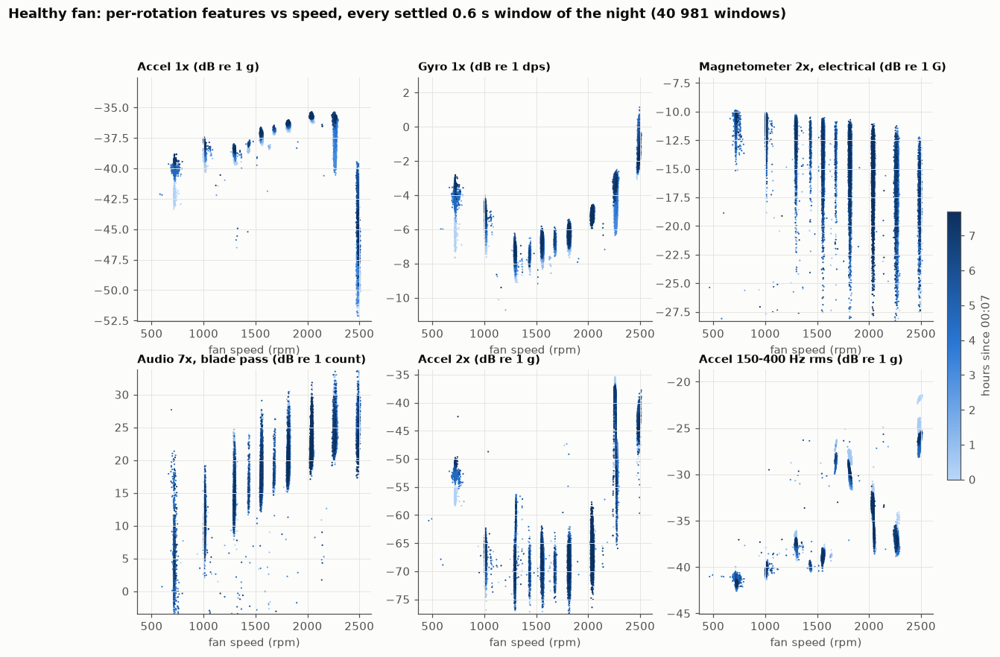
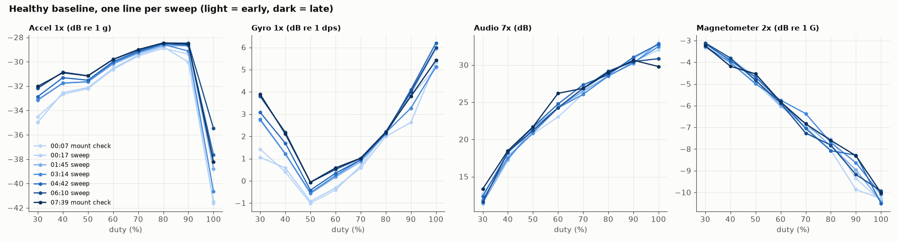

# Overnight healthy-fan campaign, 18–19 Nov 2026

The fan was healthy: a Thermalright TL-H12-X28-R7, 120 mm, standing free on its edge on a wooden floor. The Feather nRF52840 Sense was taped flat on the top edge of the fan frame near a corner (mount id `tapeCorner`). Photo and axis mapping: [`docs/setup/bench_setup.md`](../../../docs/setup/bench_setup.md). The campaign ran from 00:07 to 07:49, with logger 0.3.0 for the recordings and 0.3.1 for the morning tach check. It was recorded with `host/fanlog/campaign.py` and analysed with the scripts in `host/analysis/`.

## Summary

- **Data.** 7.4 h of continuous, clean data from every onboard sensor in 22 sessions:
  - Accel and gyro: 22.1 M samples each.
  - Magnetometer: 7.3 M samples.
  - Audio: 7.4 h at 16 kHz.
  - Temperature, humidity, pressure, light and tach.

  There were 0 CRC errors, 0 lost frames, 0 IMU overruns and 0 gaps. The only losses were two 16 ms audio drops at session boundaries.
- **Placement verdict.** The tape mount worked: the fan shows clearly on every motion sensor (1× is about 40 dB above the noise floor) and nothing came loose. The caveats are below: a slow drift over the night and rocking at full speed, both from the fan standing free on its edge.
  - **Update 19 Nov morning:** the fan was moved to lie flat (mount `flat4`, see [`docs/setup/bench_setup.md`](../../../docs/setup/bench_setup.md)), which removed the rocking.
  - The "mount resonances" in the first version of this report turned out to be aliased motor orders (see section 3).
- **The main feature finding.** Per-rotation (order) amplitudes, computed against an accurate fan speed, are very stable and generalise to speeds the model never saw:
  - The current 48 fixed-frequency features raise **93 %** false alarms at unseen speeds.
  - Order features raise **0.26 %**.

  This is strong evidence for switching step 1 to order-normalised features.
- **Bug found and fixed.** The tach speed was wrong by +1–1.6 % and noisy, because `micros()` on this core only ticks every 976 µs. Fixed in **logger 0.3.1**, which is already on the board and verified against the audio blade-pass frequency to within 0.15 %. Last night's data was re-analysed with a speed reference derived from the audio.
- **Fan facts learned from the data:**
  - 7 blades: the audio blade-pass peak is at 7×.
  - 4-pole motor: the magnetometer peak is at 2× (electrical frequency).
  - A 12× family in accel and audio is probably motor cogging.

## 1. What was recorded

| Cycle (×5, about 90 min) | Content |
|---|---|
| `speed_sweep` | 30→100 % in 10 % steps, 2 min each |
| `constant_10min` | 70 % for 10 min |
| `benign_drift` | slow ramps through 40–90 %, including **55 % and 65 %, which never appear in a sweep** |
| `steady` (30 min) | one duty per cycle: 50, 90, 30, 60, 80 % |

A 10-min `mount_check` ran at the start (00:07) and at the end (07:39). Its steps are 100 % warm-up, 30–100 % in 40 s steps, a 3-min hold at 70 % and a repeat of 50 %.

| Sensor | Rate | Notes |
|---|---|---|
| Accelerometer (LSM6DS33) | 827 Hz | ±4 g, 400 Hz anti-alias filter, hardware FIFO |
| Gyroscope (LSM6DS33) | 827 Hz | ±125 dps, same FIFO and indices as the accelerometer |
| Magnetometer (LIS3MDL) | 274 Hz | polled with no FIFO, so about 0.9 % of samples are missed (expected) |
| Microphone (PDM) | 16 kHz | gain 20 |
| SHT30, BMP280, APDS9960 | 1 Hz | temperature/humidity, pressure, light |
| Fan tach | 4 Hz STATUS | 2 pulses/rev |

The room went from 26.0 to 23.8 °C over the night. The light sensor read 1 (dark) all night.

## 2. Bug: fan speed (fixed in logger 0.3.1)

On the Adafruit nRF52 core, `micros()` is derived from the 1024 Hz FreeRTOS tick, so tach edge times were quantised to 976 µs. This had three effects:

- **The 500 µs glitch filter could not work.** PWM noise on the open-collector tach line adds extra falling edges, mostly while the line rises slowly through the pull-up, about half a period after a real edge. Under PWM the logger counted **1.0–1.6 % too many pulses**. At 100 % duty there is no PWM switching, so the count was exact.
- **Per-STATUS speed came in 120 rpm steps** (pulses per 250 ms), with noise of 23–55 rpm.
- **Order features suffered.** Every per-rotation feature looks for a peak at k × speed; with the speed off by 1 %, the 7× and 12× bands miss their peaks. Before the fix, the noise (sd) of the audio blade-pass feature during a hold was 0.49 log10, about a factor of 3.

The fix in 0.3.1 has three parts:

- TIMER4 runs free at 1 MHz (on the crystal) as the tach clock.
- An edge is rejected if the line is already high again, or if it comes sooner than ¾ of the last period.
- STATUS now carries `tach_edge_us` (the time of the last accepted edge) and `tach_rejected`. The host computes speed as Δpulses / Δedge-time, which is exact. Older recordings still decode.

| Check at 5 duties (morning, 3 min) | 0.3.0 | 0.3.1 |
|---|---|---|
| Tach mean vs audio 7×/7 | +1.0 to +1.6 % | within 0.15 % |
| Speed noise per STATUS (250 ms) | 23–55 rpm | 1–9 rpm |
| Glitch edges rejected | — | 110 in 3 min |

For last night's data, `host/analysis/windows.py` uses the tach pulses over ±2 s, refined per window by the audio blade-pass peak. That brought the blade-pass noise from 0.49 to 0.11 and accel 8× from 0.45 to 0.05.

The board's own time base (STATUS `t_us`) runs on the RC oscillator and is 0.23 % fast relative to the crystal; audio comes out at exactly 16 000 Hz on crystal time. Features are unaffected because every stream uses the same board time, and the analysis corrects the tach clock to it.

## 3. What each sensor sees


Peaks that line up across speeds when plotted against rotation order belong to the fan. Peaks that don't line up are either fixed-frequency structural resonances or aliases (below).

- **Accelerometer.**
  - 1× dominates; 2× and the 6–8× and 12–14× families are also present.
  - Lines that don't line up across speeds and wobble over time (near 100 and 266 Hz at 70 %) are **aliases, not mount resonances.**
    - **Cause:** the motor's strong 24×, 36× and 48× orders (700–1450 Hz) get past the IMU's 400 Hz analog filter and fold back into 0–414 Hz.
    - **Evidence:** at 1815 rpm they land at 101 and 262 Hz, which matches. The same lines appear on the new `flat4` mount at the predicted frequencies (121 and 232 Hz at 1766 rpm).
    - **Why they wobble:** an alias of the 36× order moves 36 times as much as 1× does, so a small speed jitter makes it wander.
    - **Effect on features:** order features up to 12× are hardly affected, but fixed-Hz band features are.
    - **Fix for later** (not mid-experiment): run the IMU at 1.66 kHz, or use the 200 Hz analog filter.
  - At 90–100 % a **0.5× family** appears (0.5×, 1.5×, 2.5×). That is rocking at half the running speed, the classic sign of something loose. The axis split (section 8) shows it is the **whole fan rocking on the floor**, not the board on the tape.
- **Gyroscope.** The cleanest 1×: a pure rotation-rate signature of the frame wobbling once per revolution. It shows the same 0.5× family at high speed.
- **Magnetometer.** A peak at **2×**, the motor's electrical frequency, so the motor has 4 poles. The peak is broad because the magnetometer is polled and its timing jitters. Its amplitude falls with speed.
  - It is the **most repeatable feature of the night** (1–2 % between sessions).
  - It sees the motor, not the mechanics, so it is unlikely to respond to an imbalance. It is useful as a speed and electrical reference.
- **Microphone.**
  - **7× is the blade pass, so the fan has 7 blades.** Its harmonics 14×, 21× and 28× are also present.
  - Separate lines at 24× and 36× match the accelerometer's 12×. A 4-pole, 6-slot motor has 12 cogging steps per revolution, so the 12× family is probably motor cogging.
  - Broadband air noise rises steeply with speed.

## 4. Baselines vs speed



- **Accel 1×** is roughly flat from 30 to 90 % (−40 to −36 dB re 1 g, about 10–16 mg), then drops about 10 dB at 100 %, where the 0.5× rocking takes over.
  - Imbalance force grows with speed² (F = m·r·ω²). An added mass should therefore show most at **80–90 %** and change the *shape* of 1× vs speed, not only its level.
- **Gyro 1×** is lowest at 50 % and rises steeply above 80 %.
- **Audio blade-pass** rises about 20 dB from 30 to 100 %.
- **Accel 2× and 150–400 Hz energy** jump at 90–100 %, along with the 0.5× rocking.

## 5. Noise, repeatability and drift

| Feature | Typical spread within a hold (robust) | Spread between sessions | Smallest increase detectable from a 30 s average (3σ) |
|---|---|---|---|
| Accel 1× | ±1–3 % | 3.5 % (2–4 % at 50–90 %) | **15 %** |
| Gyro 1× | ±3–4 % | 3.8 % | **15 %** |
| Magnetometer 2× | ±29 % per window | 1.9 % | 13 % |
| Audio 7× (blade pass) | ±33 % per window | 5 % | 20 % |
| Accel rms (all) | ±1 % | 5 % | 15 % |
| Accel 150–400 Hz | ±3 % | 8 % | 25 % |

How to read the table:

- The between-session spread includes all of the night's drift, so the last column is the conservative "compared with a baseline from any time last night".
- Against a baseline recorded **right before** a fault, accel and gyro 1× can resolve changes of a few percent.
- A few outlier windows (bumps, transients) widen the plain sd, so detection should use the **median of several windows**, not single windows.



**Drift over the night.** Comparing the 07:39 mount check with the 00:07 one:

- Accel and gyro 1× rose **+23–33 % at 30–40 %**, +10–13 % at 50–60 % and +5–10 % at 70–90 %. The rise was steady through the night, not a single jump.
- The axial (z) 1× at 70–90 % fell about 30 % during the **first hour** after taping, then stayed put (settling).
- The gravity direction crept by **0.2°** over the night, gradually.
- Fan speed at a fixed duty slipped about 0.8 %.
- Magnetometer and blade-pass audio did not change (within ±5 %).
- The correlation with room temperature is weak (|r| ≤ 0.17), so the drift follows time more than temperature.

Most likely the fan, standing free on the floor, is settling, and/or the tape adhesive is creeping and the wires are pulling on the board. It is small at the speeds that matter (≤ 10 % at 60–90 %) and well below what a real imbalance should do, but it is why the plan below uses A-B-A.


## 6. Disturbances

- **Bumps.** Only **4 impulsive accelerometer windows** all night (00:12 and 01:32), detected with the 150–400 Hz band at more than 8 robust sd. None appeared in the audio.
- **Audio level.** Audio level naturally swings by about ±2.7 dB per 0.6 s window. Windows more than 6 dB above their median (2.6 %) are spread over the whole night, including 4–6 am. **Correction to my midnight message:** I attributed the loud audio windows to you being awake, but most are just normal audio fluctuation. Audio level on its own is a poor disturbance flag; the accelerometer high band is a good one.

## 7. Anomaly detector on healthy data (false alarms)

- **Current 48 fixed-Hz feature autoencoder**, trained on the first 5 sessions:
  - 3.75 % false alarms on the rest of the night, against the 1 % expected at a 99th-percentile threshold.
  - The worst case is 07:07 (steady 80 %, 32 %). The flagged bands are 10–20 Hz and 30–40 Hz (0.5× and 1× at 80 %), which drifted up all night. That is the drift from section 5; nothing happened at 07:07.
- **Unseen speeds.** The autoencoder was trained only on the sweeps and tested on everything else; 55 % and 65 % never appear in a sweep.


  - Fixed-Hz features fail completely at a speed they haven't seen (93–100 % false alarms): every peak lands in a different band. Adding rpm as an input doesn't help.
  - **Order amplitudes plus log rpm generalise: 0.26 % at unseen speeds.** That uses 35 features from accel, gyro, magnetometer and audio.
  - Without audio: 2.4 %. Accel orders only: 7 %.
  - Caveat: the unseen test is only two speeds (55 % and 65 %), all from the same night and mount.
- **Implication for step 1.** Use order-normalised features (amplitudes at k × running speed, from accel and gyro, plus audio if the edge budget allows), with the 0.3.1 tach as the speed reference. Track the healthy baseline as a function of speed rather than per speed band.

## 8. Placement verdict

**Keep the current tape placement for the fault test.** It passes everything that matters:

- Strong 1× on accel and gyro.
- Repeatable baselines (2–4 % at 50–90 %).
- No loosening, and only 0.2° of creep over 7.7 h.
- Clean data.

**Which way things move** (07:39 mount check). Board axes, from gravity and the in-plane magnetometer signal: z is up, y is along the fan axis, x is horizontal in the rotor plane.

| Duty | Accel 1× x / y / z (mg) | Accel 0.5× y (mg) | Gyro 1×, main axis |
|---|---|---|---|
| 40 % | 1.9 / **28.7** / 1.5 | 0.1 | about x (1.3 dps) |
| 70 % | 2.2 / **35.5** / 1.2 | 1.0 | about x (0.9 dps), z (0.6 dps) |
| 90 % | 3.3 / **37.2** / 1.2 | 9.9 | about z (1.2 dps), x (0.9 dps) |
| 100 % | 4.0 / 12.9 / 1.1 | **37.2** | 0.5× about x (1.4 dps) |

- **The healthy 1× is the whole fan rocking fore-and-aft** on its narrow (28 mm) edge, once per revolution. A fan standing free on the floor is softest in this direction.
- At 90–100 % that rocking switches to half speed (0.5×): the frame is rattling on the floor.
- So the "looseness" is the fan's footing, not the tape.

Known limits:

1. **Slow drift**, up to +30 % at low speed over 7 h. Handled by recording healthy references close in time to the fault runs.
2. **0.5× rocking at 90–100 %** from the fan's footing. Treat 100 % separately or leave it out of the fault comparisons.
3. **Extra lines near 100, 170 and 266 Hz.** These are aliased motor orders, not the mount (section 3). They only affect fixed-frequency features, which section 7 recommends dropping anyway.

A future improvement (not before tonight, and under a new `--mount` id): fix the fan to a heavy base through its screw holes, or stand it on a rubber mat, and strain-relieve the wires near the board. That would most likely remove points 1 and 2.

## 9. Plan for tonight (Blu-Tack imbalance)

Update 19 Nov: the fan now lies flat (`flat4`). The plan is unchanged, but the healthy reference must be recorded on `flat4`. On `flat4` the in-plane 1× (x, z) baseline is about 1 mg at 30–70 %, so that is where the mass should show best.

1. **Don't touch the fan or the board before the run.** Logger 0.3.1 is already flashed.
   - Mark the fan's position on the floor (tape at two corners) and leave the cables as they are.
   - When adding mass, unplug the 12 V supply and hold the frame still. Don't lift or slide the fan, and don't touch the board or its wires.
2. **A-B-A design**, so a change can be blamed on the mass and not on the drift or on touching the fan:
   - **A (healthy reference):** `mount_check` plus one `speed_sweep`, right before.
   - **Sham:** touch and press the blade as if adding Blu-Tack, but add nothing, then one sweep. This measures what handling alone does to the mount.
   - **B (fault):** add the mass, then sweep plus 10-min holds at 50, 70 and 90 %. Repeat for 2–3 mass levels.
   - **A again:** remove the mass, one sweep. Do the features return to baseline?
3. **Mass.** Start small: about **0.1 g** near the blade root (radius about 20–30 mm), then about 0.3 g and 0.5 g. To get equal small pieces, weigh a larger lump (e.g. 2 g) and split it into 20 equal balls.
   - **Safety:** at 2500 rpm a piece at 45 mm radius feels about 300 g of centrifugal acceleration; 0.1 g pulls with about 0.3 N.
   - Press it on firmly, put a strip of tape over it, and keep your face out of the blade plane.
   - Start each new mass at 30–50 % before going faster.
4. **Commands** (the campaign tool takes the labels):

   ```
   python -m fanlog.campaign --port COM6 --fan pc01 --mount flat4 --fault imbalance --severity 0.1g@25mm --until 07:30
   python -m fanlog.record --port COM6 --fan pc01 --mount flat4 --fault imbalance --severity 0.1g@25mm --audio --profile host/profiles/speed_sweep.json
   ```

5. **What I'll look at:**
   - **Accel 1× in x and z.** The mass adds a force that rotates in the rotor plane. The healthy baseline there is only 1–4 mg, against about 30 mg fore-aft (y).
     - Rough size: 0.1 g at 25 mm and 1800 rpm gives about 0.09 N. If it moved a 160 g fan freely, that would be about 57 mg.
     - The floor holds the fan back, so expect much less. Even so, a clear rise above the 2 mg baseline is likely.
     - (160 g is borrowed from a similar Thermalright 120 mm fan; the R7's weight isn't published.)
   - Accel and gyro 1× vs speed (the expected signature is extra 1× growing with speed²).
   - The 1×-vs-speed slope.
   - 1× direction (axis split).
   - Whether the 0.5× family or 2× changes.
   - Whether the order-feature autoencoder trained on tonight's healthy reference flags the fault while staying quiet on the sham and the second A.

## 10. Files and how to rerun

Raw sessions are in `data/raw/20261119-*` (2.4 GB, not in git). The campaign log is `data/raw/campaign_20261119-000706.log`.

Pipeline (run from the repo root with `PYTHONPATH=host`):

```
python host/analysis/windows.py data/raw/<session> ...   # per-window features -> results/own/overnight/windows/ (cache, not in git)
python host/analysis/night_summary.py --blades 7         # summary.json + figs/
python host/analysis/repeatability.py                    # repeatability.json + figs/baseline_repeatability.png
python host/analysis/mount_drift.py                      # mount_drift.json + figs/mount_drift.png
python host/analysis/report_figs.py                      # figs/report_*.png
python host/analysis/autoproc.py <campaign log>          # runs windows/summary automatically during a campaign
```

Results in this folder:

- `summary.json`: stability, temperature correlation, disturbances and the autoencoder tests.
- `repeatability.json`: sweep spread, start-vs-end comparison and detectable change.
- `mount_drift.json`: gravity tilt and speed per session.
